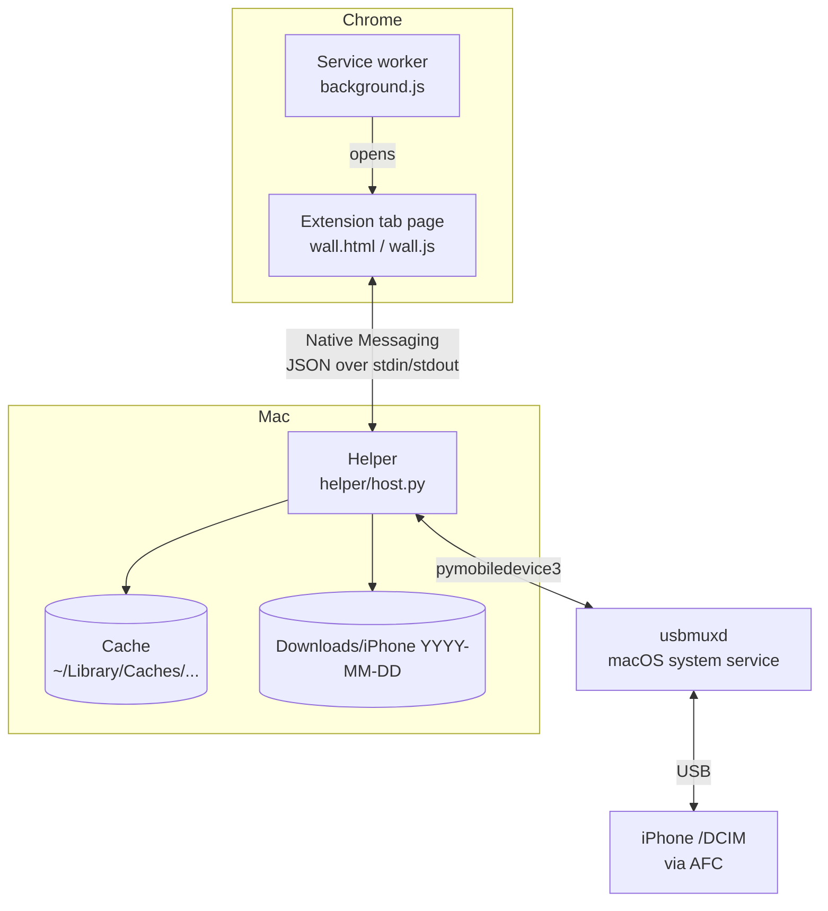

# Design

**English** | [中文](DESIGN.zh-CN.md)

This document explains how the project is built and, more importantly, why. Most decisions are trade-offs. The rejected alternatives are listed so that you can tell whether a decision still holds when circumstances change.

## 1. The job

> Plug in → see today's photos → pick a few → export the originals.

Four principles follow from that sentence, and every later decision is checked against them:

1. **Fast to the first useful screen.** Seeing the newest photos within seconds matters more than seeing all of them.
2. **Light.** No library, no sync, no background service. The phone stays the source of truth.
3. **Read-only.** Nothing ever writes to or deletes from the phone.
4. **The browser is the workbench.** The selected photos are usually headed for something in the browser.

Explicit non-goals: managing a photo library, editing photos, replacing iCloud, and deleting photos. Delete is excluded even as an option, not merely hidden behind a confirmation.

## 2. Architecture

| Part | Responsibility |
|---|---|
| `extension/background.js` | Clicking the toolbar icon opens the photo page, or focuses it if it is already open. |
| `extension/wall.*` | All UI: device status, photo wall, selection, preview, export progress. |
| `helper/host.py` | Talks to the iPhone, lists photos page by page, makes thumbnails and previews, writes exports. |
| `install.sh` | Creates a private Python environment and registers the helper with Chrome. |

## 3. Key decisions

### 3.1 A browser tab, not a popup and not a Mac app

- **Popup rejected.** A Chrome extension popup closes as soon as it loses focus, and its size is capped. A half-finished selection would be lost by a stray click.
- **Native Mac app rejected.** It would separate the photos from where they are going, which is the browser. A tab also leaves room for future steps such as sending the selection straight into the page you are working on.

### 3.2 Native Messaging, not a local web server

The helper is registered as a Chrome Native Messaging host. Chrome starts it when the photo page connects and stops it when the connection closes.

- No open port, so no other website or program on the Mac can talk to it.
- No background process between uses.
- Only the extension with the ID in `allowed_origins` may launch it.

**Cost:** one message from the helper to Chrome is limited to 1 MB. Consequences:

- Thumbnails (~25 KB) and previews (capped at ~650 KB before base64) travel as messages.
- **Exported files never pass through Chrome.** The helper writes them to disk directly.

### 3.3 AFC instead of Apple's ImageCaptureCore

This was the most important choice.

ImageCaptureCore is the official framework behind Image Capture. It can enumerate photos and fetch thumbnails on demand. However, **it decides the order in which it catalogs the camera roll**, and that order cannot be controlled. If it catalogs oldest first, today's photos arrive last, and the first screen is slow exactly when you want it fast.

AFC is the iPhone's file service. It exposes the camera roll as plain folders (`/DCIM/100APPLE/IMG_0001.HEIC`, …) to a trusted computer without jailbreak. With AFC we choose the order ourselves:

1. List the folders in `/DCIM` and take the newest one.
2. List only that folder, newest file names first.
3. Return one page at a time.

There is a second benefit. AFC reads the file as stored, so **HEIC stays HEIC**. Transfers through the camera protocol may instead convert to JPEG, depending on the iPhone setting "Transfer to Mac or PC".

**Cost:** AFC is not a public Apple API. We depend on [pymobiledevice3](https://github.com/doronz88/pymobiledevice3), a reverse-engineered implementation, and major iOS updates could break it until the library catches up. The version is pinned in `helper/requirements.txt` for that reason.

### 3.4 Making the first screen fast

"Show the newest photos within seconds" breaks down into four mechanisms:

**Paged listing.** The first request lists 30 items and later requests list 60. Only the files on the current page are queried for size and date.

**Thumbnails only for what is on screen.** Each tile is watched with an `IntersectionObserver` that reaches 600 px beyond the viewport. Visible tiles queue for a thumbnail, at most 4 requests run at once, and the most recently visible tile goes first (LIFO), so the place you are looking at loads first. Tiles that scroll away before their turn are dropped from the queue.

**Embedded HEIC thumbnails.** iPhone HEIC files contain a small thumbnail. Reading it takes about 2 ms, compared with about 140 ms to decode the full 12-megapixel image. The grid uses the embedded thumbnail. A full decode happens only when you open the large preview. JPEGs are decoded at 1/8 scale (DCT scaling), which is also fast.

On a mock set of 20 photos, thumbnail time dropped from **5.4 s to 0.45 s** with this change. These numbers come from a test machine without USB transfer, so real-device numbers will be higher. `selftest.sh` measures yours.

**Disk cache.** Thumbnails and previews are cached by device, path, and size, so reopening the page is near-instant for photos already seen.

### 3.5 How "newest" is decided

Folders are sorted by name, descending (`101APPLE` before `100APPLE`). Files within a folder are sorted by name, descending. Capture time comes from the file's creation time on the phone, and the preview shows the EXIF time when available.

This is a heuristic. It is cheap because it needs no per-file queries, and it matches the usual iPhone naming. If a phone names folders differently, the order may be wrong. That is the first thing to check when someone reports "my newest photos are not first".

### 3.6 Grouping files into one photo

Files in the same folder that share a name stem become one item:

| Files | Becomes |
|---|---|
| `IMG_1.HEIC` + `IMG_1.MOV` | Live Photo: shows the HEIC, exports both |
| `IMG_2.DNG` + `IMG_2.HEIC` | One photo: shows the HEIC, exports both |
| `IMG_3.MOV` alone | A video |
| `IMG_4.AAE` | Ignored (edit sidecar) |

### 3.7 Export

- **Destination:** `~/Downloads/iPhone YYYY-MM-DD/`.
- **Safe writes:** each file is written to a `.part` file first, then renamed, so a cut cable never leaves a half-file under the real name.
- **Original times:** the file's modification time is set to the original capture time.
- **No duplicates:** if a file with the same name and size already exists, it is skipped. A different file with the same name gets `(1)` appended.
- **Progress:** reported to the page every ~150 ms.

### 3.8 Read-only by construction

The helper only uses `listdir`, `stat`, and reads on the phone. pymobiledevice3 offers delete and write calls, and **they are intentionally never imported or called**. Please keep it that way in contributions. Features such as "clean up blurry photos" should produce suggestions, not deletions.

### 3.9 A fixed extension ID

`manifest.json` contains a public `key`, so the unpacked extension always gets the same ID (`endldjnpicempoibdmlndkiinmmekggn`) on every machine. That lets `install.sh` register the helper for exactly that ID.

## 4. Message protocol

The page sends `{rid, cmd, ...}`. The helper answers `{rid, ok: true, result}` or `{rid, ok: false, code, error}`. Export progress arrives as `{event: "progress", rid, ...}`.

| cmd | Arguments | Result |
|---|---|---|
| `hello` | — | `{version}` |
| `status` | — | `{state}` where state is `ready`, `nodevice`, `pairing`, `locked`, `denied`, or `error`; plus `name`, `model`, `ios` when ready |
| `list` | `cursor`, `limit` | `{items, cursor}`; `cursor` is `null` at the end |
| `thumb` | `id` | `{thumb (base64 JPEG), w, h, taken, noThumb, cached}` |
| `preview` | `id` | `{data (base64 JPEG)}` |
| `export` | `ids` | `{dir, files, skipped, count}` |
| `refresh` | — | Forgets the listing so new photos show up |
| `reveal` | `path` | Opens the export folder in Finder |

Error code `device_lost` means the phone was disconnected. The page then returns to the "connect your iPhone" screen.

## 5. Known gaps and open questions

- **Edits made on the phone:** the camera roll stores originals. Edits are kept elsewhere by Photos, so exports are probably unedited. This has not been fully verified.
- **iCloud "Optimize iPhone Storage":** photos stored only in iCloud may be missing from `/DCIM`.
- **Folder-name ordering:** see 3.5.
- **Video:** first-frame thumbnails ignore rotation metadata, and videos over 60 MB get none.
- **Interface language:** Chinese only.
- **Platform:** macOS + Chrome only. pymobiledevice3 also runs on Windows and Linux, so a port is plausible but untested.

## 6. Roadmap (ideas, not promises)

The long-term shape is **Access → Select → Transform → Share**:

1. **Access and Select:** this is v0.1.
2. **Transform (AI-assisted):** find photos by description ("screenshots with an error message"), group near-duplicates, flag blurry shots, pick the best of a burst. These start on recent photos only, and produce suggestions only, never deletions.
3. **Share:** a selection tray that can send photos to destinations: a folder, a blog or CMS through its API, or a web page you are on, with the final "post" click left to you.

Each step should keep the principles in section 1. If a feature needs to break one, that is a reason to rethink the feature.
