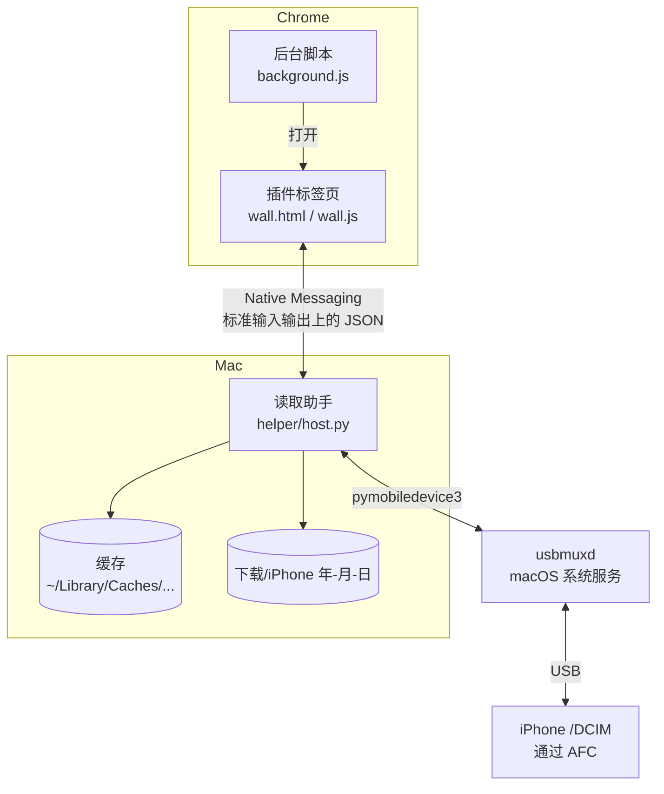

# 设计说明

[English](DESIGN.md) | **中文**

这份文档说明项目是怎么做的，更重要的是为什么这么做。大多数决定都是取舍，所以每个决定都列出了被否掉的方案。条件变了的时候，你可以据此判断这个决定还成不成立。

## 1. 要完成的事

> 插线 → 看今天的照片 → 挑几张 → 导出原文件。

这句话推出四条原则，后面每个决定都拿它们来检验：

1. **首屏要快**：几秒内看到最新的照片，比看到全部照片更重要。
2. **轻**：不建图库，不同步，不常驻后台。手机始终是唯一的数据源。
3. **只读**：任何时候都不写入、不删除手机上的东西。
4. **浏览器就是工作台**：选出来的照片通常是要用在浏览器里的。

明确不做的事：管理图库、编辑照片、替代 iCloud、删除照片。删除连选项都不提供，不是藏在一个确认框后面。

## 2. 整体结构

| 部分 | 职责 |
|---|---|
| `extension/background.js` | 点工具栏图标时打开照片页；已经开着就切过去 |
| `extension/wall.*` | 全部界面：设备状态、照片墙、选择、预览、导出进度 |
| `helper/host.py` | 和 iPhone 通信，分页列照片，生成缩略图和预览，写出导出文件 |
| `install.sh` | 建一个独立的 Python 环境，并把读取助手注册到 Chrome |

## 3. 关键决定

### 3.1 用浏览器标签页，不用弹出窗，也不做 Mac App

- **不用弹出窗**：Chrome 插件的弹出窗一失去焦点就关闭，尺寸也有上限。选到一半，手一滑点到别处，选择就丢了。
- **不做 Mac App**：那样照片和它要去的地方（浏览器）就分开了。用标签页还给以后的功能留了空间，比如把选中的照片直接送进你正在用的网页。

### 3.2 用 Native Messaging，不起本地网页服务

读取助手注册为 Chrome 的 Native Messaging 程序。照片页连接时 Chrome 启动它，连接断开时它退出。

- 不开端口，Mac 上的其他网站或程序都连不上它。
- 两次使用之间没有后台进程。
- 只有 `allowed_origins` 里那个 ID 的插件能启动它。

**代价**：读取助手发给 Chrome 的单条消息上限是 1 MB。由此带来两点：

- 缩略图（约 25 KB）和预览图（base64 编码前限制在约 650 KB）走消息传。
- **导出的文件完全不经过 Chrome**，由读取助手直接写盘。

### 3.3 用 AFC，不用苹果的 ImageCaptureCore

这是最重要的一个选择。

ImageCaptureCore 是“图像捕捉”背后的官方框架，能列照片，也能按需取缩略图。但**它按什么顺序给相机胶卷编目，由它自己决定，外部控制不了**。如果它先编旧的，今天的照片就最后才到，偏偏在你最想快的时候慢。

AFC 是 iPhone 的文件服务。对已信任的电脑，不越狱也能把相机胶卷当普通文件夹访问（`/DCIM/100APPLE/IMG_0001.HEIC` 这样）。用 AFC，顺序由我们自己定：

1. 列出 `/DCIM` 下的文件夹，取最新的那个。
2. 只列这一个文件夹，文件名从新到旧。
3. 每次只返回一页。

还有一个附带的好处：AFC 读的是手机上存储的原文件，所以 **HEIC 就是 HEIC**。而走相机协议传输时，是否把照片转成 JPEG 取决于 iPhone 的“传输到 Mac 或 PC”设置。

**代价**：AFC 不是苹果公开的 API。我们依赖 [pymobiledevice3](https://github.com/doronz88/pymobiledevice3)，它是逆向实现的。iOS 大版本升级后，可能要等这个库跟进才能用。所以 `helper/requirements.txt` 里锁定了它的版本。

### 3.4 首屏怎么做快

“几秒内看到最新照片”拆成四个机制：

**分页列目录**：第一次只列 30 项，之后每次 60 项。只对当前这一页的文件查询大小和时间。

**只为屏幕上的照片取缩略图**：每个格子用 `IntersectionObserver` 盯着，观察范围超出可视区 600 像素。进入范围的格子排队请求缩略图，最多同时 4 个，最近进入视野的先处理（后进先出），所以你正在看的位置最先出图。轮到之前就滚走的格子会从队列里丢掉。

**用 HEIC 内嵌的缩略图**：iPhone 的 HEIC 文件里自带一张小缩略图，读它大约 2 毫秒，而完整解码一张 1200 万像素的原图大约要 140 毫秒。照片墙用内嵌缩略图，只有放大看大图时才完整解码。JPEG 按 1/8 比例直接解码（DCT 缩放），也很快。

在 20 张模拟照片上，这一改动把缩略图耗时从 **5.4 秒降到 0.45 秒**。这组数字来自测试机，不含 USB 传输，真机会更慢一些。你的手机的实际数字可以用 `selftest.sh` 测。

**磁盘缓存**：缩略图和预览按“设备 + 路径 + 大小”缓存，看过的照片再次打开几乎是瞬间。

### 3.5 怎么判断“最新”

文件夹按名字倒序排（`101APPLE` 在 `100APPLE` 前面），文件夹内的文件也按名字倒序。拍摄时间取手机上文件的创建时间；预览里如果有 EXIF 拍摄时间，会显示 EXIF 时间。

这是一个经验规则。它的好处是便宜，不需要逐个查询文件，而且符合 iPhone 通常的命名方式。如果某部手机的文件夹命名规则不同，顺序就可能不对。有人报告“最新的照片没排在最前”时，先查这一条。

### 3.6 把文件归成一张照片

同一个文件夹里、文件名主干相同的文件合并成一项：

| 文件 | 合并成 |
|---|---|
| `IMG_1.HEIC` + `IMG_1.MOV` | 实况照片：显示 HEIC，导出两个文件 |
| `IMG_2.DNG` + `IMG_2.HEIC` | 一张照片：显示 HEIC，导出两个文件 |
| 单独的 `IMG_3.MOV` | 视频 |
| `IMG_4.AAE` | 忽略（编辑信息附属文件） |

### 3.7 导出

- **位置**：`~/Downloads/iPhone 年-月-日/`。
- **安全写入**：先写成 `.part` 临时文件，写完再改名。中途拔线也不会在正式文件名下留下半个文件。
- **保留时间**：文件的修改时间设为原始拍摄时间。
- **不重复**：同名且大小相同的文件已存在就跳过；同名但不同的文件，名字后面加 `(1)`。
- **进度**：大约每 150 毫秒向页面报告一次。

### 3.8 从结构上保证只读

读取助手对手机只用到列目录、查文件信息和读文件。pymobiledevice3 提供了删除和写入的接口，**我们刻意不引入、不调用**。贡献代码时也请保持这一点。像“清理模糊照片”这类功能，应该给出建议，而不是执行删除。

### 3.9 固定插件 ID

`manifest.json` 里放了一个公钥 `key`，所以无论在哪台电脑上加载这个未打包的插件，ID 都是同一个（`endldjnpicempoibdmlndkiinmmekggn`）。`install.sh` 就是按这个 ID 注册读取助手的。

## 4. 消息协议

页面发送 `{rid, cmd, ...}`；读取助手回复 `{rid, ok: true, result}` 或 `{rid, ok: false, code, error}`。导出进度以 `{event: "progress", rid, ...}` 推送。

| 命令 | 参数 | 返回 |
|---|---|---|
| `hello` | — | `{version}` |
| `status` | — | `{state}`，取值为 `ready`、`nodevice`、`pairing`、`locked`、`denied` 或 `error`；`ready` 时还带 `name`、`model`、`ios` |
| `list` | `cursor`、`limit` | `{items, cursor}`；到底时 `cursor` 为 `null` |
| `thumb` | `id` | `{thumb（base64 JPEG）, w, h, taken, noThumb, cached}` |
| `preview` | `id` | `{data（base64 JPEG）}` |
| `export` | `ids` | `{dir, files, skipped, count}` |
| `refresh` | — | 清掉已列出的目录，让新拍的照片能显示出来 |
| `reveal` | `path` | 在访达中打开导出文件夹 |

错误码 `device_lost` 表示手机断开了，页面会回到“用数据线连接 iPhone”的画面。

## 5. 已知不足和待验证的问题

- **手机上的编辑**：相机胶卷存的是原片，编辑由“照片”App 另外保存，所以导出的大概率是未编辑的版本。这一点还没有完全验证。
- **iCloud“优化 iPhone 储存空间”**：只存在于 iCloud 的照片，`/DCIM` 里可能没有。
- **按文件夹名排序**：见 3.5。
- **视频**：第一帧缩略图没有处理旋转信息；超过 60 MB 的视频不生成缩略图。
- **界面语言**：只有中文。
- **平台**：只支持 macOS + Chrome。pymobiledevice3 也能在 Windows 和 Linux 上运行，移植有可能，但没测过。

## 6. 后续方向（想法，不是承诺）

长期的形态是 **取出 → 挑选 → 处理 → 分发**：

1. **取出和挑选**：就是现在的 v0.1。
2. **处理（AI 辅助）**：用一句话找图（“有报错信息的截图”）、相似照片分组、标出模糊的照片、从连拍里挑最好的。都先只针对最近的照片，而且只给建议，永不删除。
3. **分发**：一个选图托盘，把照片送到不同地方：文件夹、通过 API 发到博客或内容后台，或者送进你正在用的网页，最后点“发布”的那一下留给你自己。

每一步都要守住第 1 节的原则。如果某个功能必须打破其中一条，那就该重新想想这个功能。
